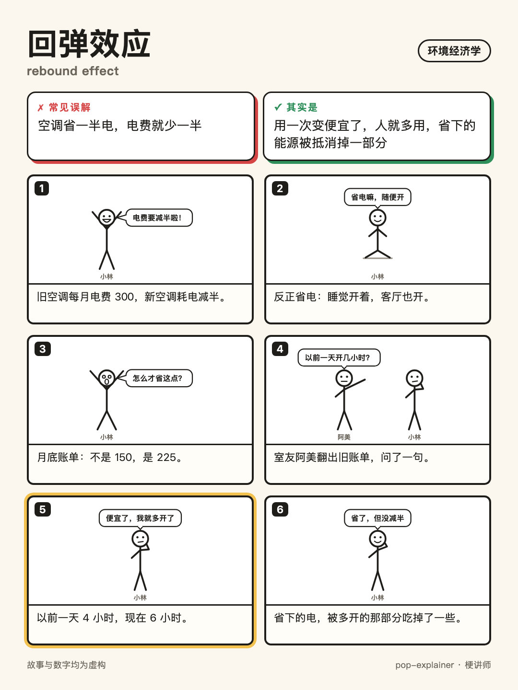
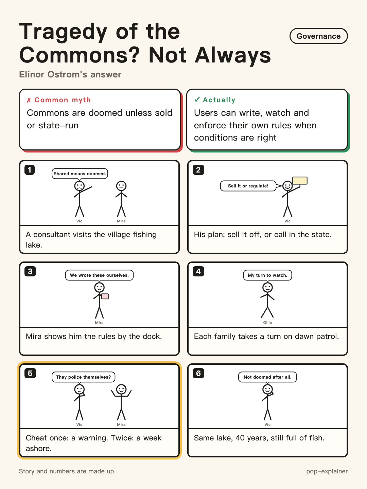

# pop-explainer（梗讲师）

**English** | [中文](README.zh-CN.md)

**Find the misconception, then flip it.** An agent skill for Claude Code, Codex and other tools that support the Agent Skills format. It explains concepts as stories, checks *your own* explanations for hidden misconceptions, builds lesson packs for teaching, and draws shareable stick-figure comic cards.

Built for **environmental policy, environmental economics and environmental politics** — a 47-concept guide covers externalities, Pigouvian taxes, the Coase theorem, carbon taxes vs. cap-and-trade, rebound effects, the Porter and pollution-haven hypotheses, Ostrom's commons, carbon leakage, environmental justice, climate negotiations and more — and it works for any concept from any field.

<p align="center">
  
  
</p>
<p align="center"><sub>Two comic cards made by <code>/comic</code> — 1080×1440, ready to post.</sub></p>

## Four modes

| Mode | Ask like this | You get |
|---|---|---|
| 🎬 **Story** (default) | "explain the rebound effect like a story" | A short story where the hero believes the common myth, acts on it, and works out why it's wrong — then the term, one warning and a quiz |
| 🩺 **Misconception check** `/checkup` | Paste *your own* notes, homework or a thesis paragraph and ask "is this right?" | Each misconception quoted back, graded 🔴 / 🟡, fixed with a short story and a corrected sentence; then your text rewritten |
| 📚 **Lesson pack** `/lesson` | "I'm teaching the Coase theorem to first-years for 20 minutes" | An opening story with a pause-and-predict moment, the definition, three class questions each with the *most common wrong answer*, where students get stuck, and a one-page handout |
| 🖼️ **Comic card** `/comic` | "turn it into a comic" | A 1080×1440 HTML card — title, myth vs. fact, six stick-figure panels with the turn highlighted — rendered to PNG |

<details>
<summary><b>🩺 Misconception check on environmental-economics notes — excerpt</b></summary>

> **Your notes:** "Emissions trading just lets firms pay for the right to pollute, so it's laxer than a carbon tax. The Coase theorem shows that if polluters compensate victims the problem is solved and government needn't intervene. And by the environmental Kuznets curve, pollution falls naturally once an economy is rich enough, so developing countries can grow first and clean up later."
>
> 🔴 **Treating "firms pay" as "it's lax"** — cap-and-trade fixes the *quantity*; a tax fixes the *price*. Which is stricter depends on where the cap or the rate is set.
>
> 🔴 **Pinning "polluter pays" and "no government needed" on Coase** — Coase says that with clear rights and *cheap bargaining*, the efficient outcome is reached whoever holds the right; his real point is that bargaining is usually expensive, so institutions matter.
>
> 🔴 **Reading an observed curve as an automatic law** — the EKC describes some local pollutants; evidence for CO₂ is weak, and turning points come with policy and technology, not by themselves.

Each item comes with a short story and an academic rewrite. Full output (Chinese): [`checkup-env-notes.zh.md`](skills/pop-explainer/examples/environmental-policy/checkup-env-notes.zh.md).
</details>

> **The twist must come from figuring it out, never from a lucky reveal.** No culprit is caught, no result is announced: the turn is a question, a comparison or a count you can follow. You learn the reasoning, not the ending.

## Story mode in action

**You:** explain the rebound effect like a story

> **🎬 The Story**
>
> Xiaomang's family swapped their old air conditioner for a new one. The salesman swore it would keep the flat just as cool on half the electricity.
>
> That night Dad stuck a note on the fridge: "THE HUNDRED PLAN." His maths was airtight. The AC used to cost 200 a month in electricity (all numbers made up). Half of that is 100.
>
> The Hundred Plan began.
>
> Week one, Dad said, "It's efficient now — leave it on all night."
> Week two, Dad said, "It's efficient now — turn it down from 26 to 23."
> Week three, Dad switched on the living-room unit before leaving for work. "It's efficient now. The flat'll be cool when we get home."
> Grandma drifted past, fanning herself. "I've never seen anyone work so hard at saving."
>
> The bill arrived at the end of the month: 150.
>
> Dad grabbed his coat to go back to the shop and demand a refund for a fake "efficient" machine. Xiaomang stopped him and opened the AC's app. Last month: 200 hours. This month: 300 hours.
>
> She laid it out on the table. The old unit cost 1 an hour to run; the new one costs 0.5. The machine wasn't lying — every hour really was half price. But precisely because an hour got cheaper, the whole family kept saying "it's efficient now" and ran it half as long again.
>
> Dad stared at THE HUNDRED PLAN for a long time, then added a line underneath in small letters: "Make something cheaper to use and people use more of it. We spent part of the savings running it more."
>
> He didn't return it, though. Three hundred hours on the old unit would have cost 300.
>
> **💡 This is called: The rebound effect**
>
> When something becomes more efficient, each use gets cheaper, so people tend to use it more — and the real savings end up smaller than the efficiency gain promised. Like Xiaomang's family: each hour cost half as much, but they went from 200 hours to 300, so half of the 100 they expected to save got spent on running it more.
>
> **⚠️ Don't Mix It Up**
>
> This doesn't mean efficiency is pointless — the bill still dropped by 50. In real life the rebound usually eats only part of the savings, and how big a part varies a lot by product and place; economists still argue about the size.
>
> **🤔 Your Turn**
>
> The city opens a new expressway, and the one-way commute drops from 40 minutes to 20. The transport department announces, "Total time people spend on the road each day will be cut in half." What are they missing?
>
> Tell me what you think and I'll pick it up from there. Want the answer straight away? Reply /answer

Full example: [`rebound.en.md`](skills/pop-explainer/examples/environmental-policy/rebound.en.md).

### More from environmental economics and politics

<details>
<summary><b>"What is the Coase theorem?"</b> — overturns "Coase means the two sides sort it out, no rules needed"</summary>

> 🎬 The Story
>
> Tao had just become the neighbourhood mediator. Her first case: smoke from a street barbecue stall was pouring into Mrs Wang's flat on the second floor, so she couldn't open her windows all summer.
>
> Qiang, who ran the stall, did the sums. A smoke filter would cost him 300 a month (all numbers made up). Mrs Wang said being able to open her windows was worth 500 a month to her.
>
> They talked on the stairwell for ten minutes and sorted it out: the filter went in. Tao noticed something else. Whether the rule said "the stall has the right to smoke" or "Mrs Wang has the right to clean air," that filter gets installed either way — in one case Mrs Wang pays Qiang to fit it, in the other Qiang pays for it himself.
>
> Tao stayed up all night writing a report. She called it *The Talk-It-Out Method*. Its core principle, in one line: "Let the parties negotiate. Nobody upstairs needs to get involved."
>
> The office loved it and sent her straight to Barbecue Street: 8 stalls, 120 flats upstairs.
> First meeting: 30 households showed up. Not a single stall owner.
> Second meeting: the stall owners came, and everyone spent two hours arguing about whose smoke was whose.
> Third meeting: just as they were about to chip in for a shared chimney, the man from the third floor said, "I'm not paying. If everyone else pays, I won't smell it anyway."
>
> Tao sat staring at her meeting notes. Qiang wandered by and glanced at them. "Last time, you and me — ten minutes on the stairs."
>
> Tao froze. The first deal hadn't worked because nobody upstairs got involved. It worked because there were only two households, the smoke obviously came from one place, and ten minutes was enough. Now there were over a hundred flats and eight chimneys, and just getting everyone in a room and agreeing on the numbers cost more effort than the chimney itself.
>
> She crossed out the title of her report and wrote: "When talking is cheap, people can sort it out themselves. When talking is expensive, someone has to set the rules first."
>
> 💡 This is called: The Coase theorem
>
> If rights are clearly defined and it's cheap for the two sides to negotiate, they'll bargain their way to the best outcome on their own — and it doesn't matter who got the right in the first place; that only changes who pays. Like Qiang and Mrs Wang: whatever the rule, the filter goes in. But the economist Ronald Coase was really pointing at the other half: in the real world negotiating is often expensive, like on Barbecue Street, and then how the rules are set decides whether the problem gets solved at all.
>
> ⚠️ Don't Mix It Up
>
> It isn't "the polluter pays." Even if the stall has the right to smoke, the filter still goes in — Mrs Wang just ends up paying for it.
>
> 🤔 Your Turn
>
> Two flatmates: one wants a cat, the other is allergic to cat hair. Under a rule saying "tenants may keep pets" versus one saying "tenants have the right to a pet-free home," would the cat's fate turn out any differently?
>
> Tell me what you think and I'll pick it up from there. Want the answer straight away? Reply /answer

</details>

<details>
<summary><b>"What did Ostrom say about the tragedy of the commons?"</b> — overturns "shared resources are doomed unless privatised or state-run"</summary>

> 🎬 The Story
>
> Xiaohe came home from university for the summer and found that the pond the whole village shared had fewer fish every year.
>
> He had just read a convincing idea in a book: when something belongs to everyone, everyone takes one more netful, and sooner or later it's empty. So he stayed up all night making a slideshow called *Three Steps to Save the Pond* and presented it to the village committee with a completely straight face. Step one: accept that people can't be trusted. Step two: accept that people really, truly can't be trusted. Step three: either lease the pond to a single family, or ask the town to send someone to guard it.
>
> The village head heard him out. "So step three means the pond stops being ours."
>
> Xiaohe wasn't convinced. He went next door to Willow Bend, where he'd heard there was a shared pond too — thirty years (all numbers made up), still full of fish, never leased to anyone, and the town had never sent a soul.
>
> He asked the old man who looked after it: "Aren't you worried people will take too much?"
>
> The old man counted it off on his fingers. The mesh has to be wider than three fingers, so the small fish slip back. Each household fishes twice a month, on days the whole village agreed together. Forty households take turns keeping watch at night, so the person watching you tonight is your neighbour. Take too much once and it gets said out loud in front of everyone; do it again and you're banned for a month. Outsiders? Everyone round the pond knows everyone, so a strange face gets asked questions straight away.
>
> Xiaohe went home and looked at his own village's pond, and it clicked. Anyone could come, any time, take any amount, and nobody counted and nobody said a word.
>
> He changed the first slide: "The problem isn't that we share it. It's that nobody set the rules and nobody was watching. Let the people who use the pond make the rules and take turns watching, and a shared pond can last."
>
> 💡 This is called: Self-governance of the commons (common-pool resource governance)
>
> The ecologist Garrett Hardin argued in "the tragedy of the commons" that shared resources are doomed to be used up, so the only fixes are private ownership or government control. The political scientist Elinor Ostrom studied a huge number of real cases around the world and found that users can often set their own rules, monitor each other in turns, and punish rule-breakers step by step — and keep a resource going for generations. It won her the Nobel Prize in economics. Like the pond at Willow Bend: not leased out, no one sent from town, just the villagers' own rules.
>
> ⚠️ Don't Mix It Up
>
> This doesn't mean shared things are fine if you leave them alone. Self-governance works under conditions: clear limits on who can use it, rules that fit local circumstances, users who help make the rules, monitoring, and penalties that escalate — Xiaohe's pond had none of these, and the tragedy can happen just as Hardin said.
>
> 🤔 Your Turn
>
> The office fridge is always crammed with unclaimed, out-of-date lunch boxes, and the office manager says, "Either we get rid of the fridge or we hire someone to police it." If you fixed it the Willow Bend way, which rule would you set first?
>
> Tell me what you think and I'll pick it up from there. Want the answer straight away? Reply /answer

</details>

Other fields: [regression to the mean](skills/pop-explainer/examples/regression-to-the-mean.en.md) · [prisoner's dilemma](skills/pop-explainer/examples/prisoners-dilemma.en.md) · [self-fulfilling prophecy](skills/pop-explainer/examples/self-fulfilling-prophecy.en.md) · [veil of ignorance](skills/pop-explainer/examples/veil-of-ignorance.en.md). Every example also exists in Chinese.

## Output shape

```
🎬 Story            300–500 Chinese characters (≈200–400 English words), no jargon
💡 This is called   the name, once, tied back to the story
⚠️ Don't mix it up  the one thing most likely to mislead
📌 One-liner        only when you mention an interview, exam, thesis or report
🤔 Your turn        a quiz in a different setting — answer withheld
```

Follow-ups: `/answer` `/deeper` `/retell` `/simpler` `/quiz` `/comic` `/compare` (Chinese: `/答案` `/深挖` `/换故事` `/更简单` `/考我` `/漫画` `/对比`), or just say "still don't get it" / "quiz me".

## Install

```bash
git clone https://github.com/liuxiaoyuu/pop-explainer.git
cp -R pop-explainer/skills/pop-explainer ~/.claude/skills/   # Claude Code
cp -R pop-explainer/skills/pop-explainer ~/.codex/skills/    # Codex
```

Other tools that support Agent Skills: copy `skills/pop-explainer/` into that tool's skills directory (check its docs). With the open-source `skills` CLI: `npx skills add liuxiaoyuu/pop-explainer`. Start a new session afterwards.

More on the design, the learning research behind it, and the accuracy guardrails: [`skills/pop-explainer/README.md`](skills/pop-explainer/README.md).

## Test it

`evals/prompts.md` lists five prompts (including one that must *not* get a story — a personal medication question). `evals/expected.md` says what a good answer must do; `evals/check_story.py` checks the structure:

```bash
python3 evals/check_story.py out/P2.md --terms "p-value,null hypothesis,significance"
```

## Languages

The instructions are written in Chinese; the skill answers in whatever language you write in.

## License

MIT — see `LICENSE`. Citation: `CITATION.cff`. Provenance: `PROVENANCE.md`.
