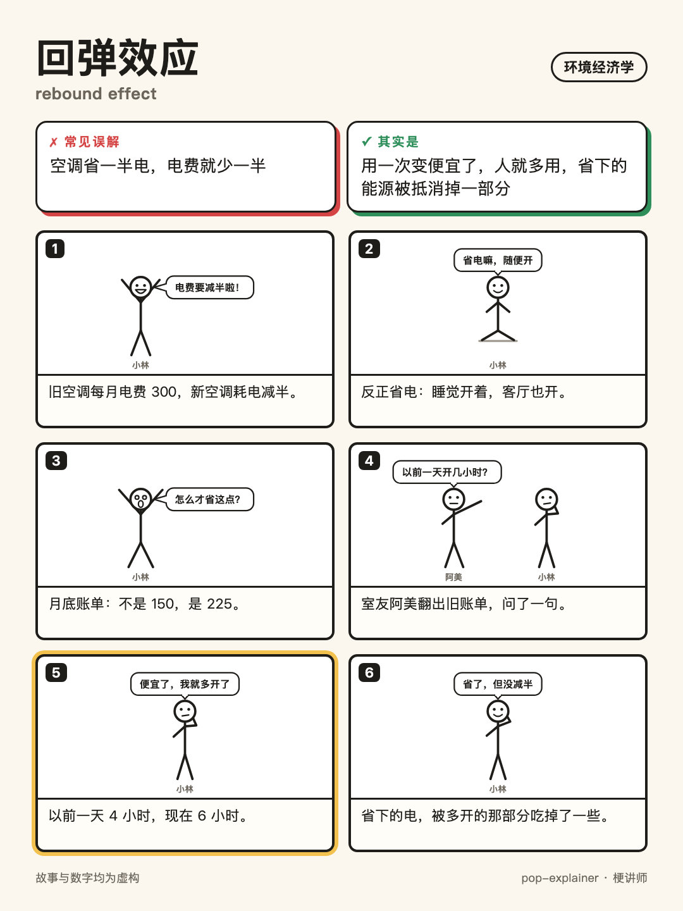
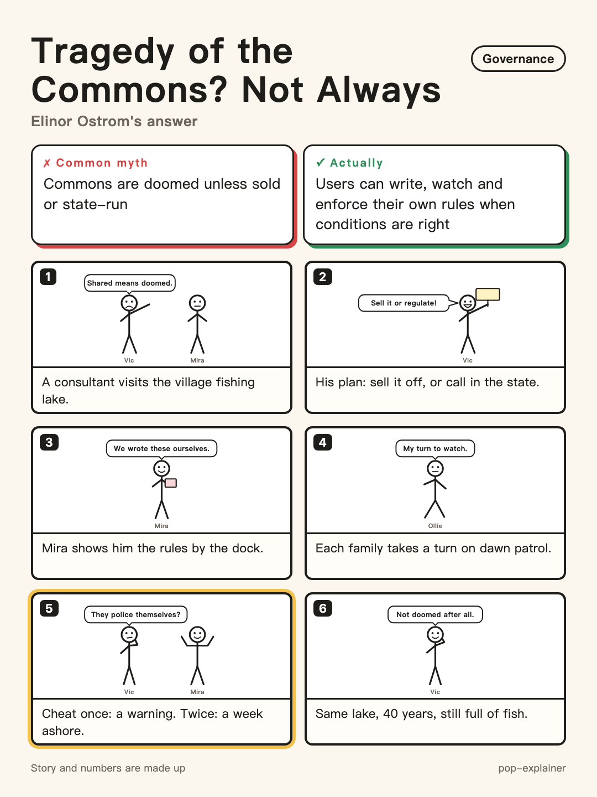

# pop-explainer（梗讲师）

[English](README.md) | **中文**

**先找出误解，再把它翻过来。** 一个 Agent Skill，适用于 Claude Code、Codex，以及其他支持 Agent Skills 格式的工具。它可以用故事讲概念，检查**你自己写的理解**里藏着哪些误解，生成上课用的课堂包，还能画成一张能分享的火柴人漫画卡。

专为**环境政策、环境经济学、环境政治**打磨：内置 47 个核心概念的易错清单，涵盖外部性、庇古税、科斯定理、碳税与碳交易、回弹效应、波特假说与污染天堂假说、奥斯特罗姆的公共池塘资源治理、碳泄漏、环境正义、气候谈判等，其他学科的概念也一样能讲。

<p align="center">
  
  
</p>
<p align="center"><sub>用 <code>/漫画</code> 生成的两张漫画卡：1080×1440，可以直接发。</sub></p>

## 四种模式

| 模式 | 怎么用 | 得到什么 |
|---|---|---|
| 🎬 **讲故事**（默认） | 「讲讲回弹效应」 | 主角先信了常见误解、照着做，再自己想通；然后告诉你它叫什么，提醒一个最容易搞混的点，出一道小题 |
| 🩺 **误解体检** `/体检` | 贴上**你自己写的**笔记、作业或论文段落，问「我理解得对吗」 | 逐条引出你写错的地方，分 🔴 / 🟡 两级，每条配一个小故事和一句改好的说法，最后把整段改写好 |
| 📚 **课堂包** `/课堂包` | 「我下周要给大一新生讲科斯定理，20 分钟」 | 带「停一下，先猜结果」环节的开场故事、定义、三道课堂小题（每道附**学生最常见的错答**）、学生最容易卡住的地方、一页讲义 |
| 🖼️ **漫画卡** `/漫画` | 「做成漫画」 | 一张 1080×1440 的 HTML 漫画卡：标题、「常见误解 / 其实是」对照、6 格火柴人漫画，转折那格高亮，并渲染成 PNG |

<details>
<summary><b>🩺 误解体检：一段环境经济课笔记</b>（碳交易、科斯定理、环境库兹涅茨曲线三处常见误读）</summary>

> ## 🩺 误解体检：碳交易 vs 碳税、科斯定理、环境库兹涅茨曲线
>
> **总评：** 三个概念名字都对，但三个"所以"都推歪了：碳交易严不严看总量，科斯定理恰恰不是"政府不用管"，库兹涅茨曲线也不保证污染会自己降。
>
> ### 🔴 把"要花钱"当成了"管得松"
> > 你写的："碳交易本质上是让企业花钱买污染的权利，所以它不如碳税严格。"
>
> **问题在哪：** 碳交易先定死排放**总量**，配额怎么买卖，总排放都超不过上限；碳税定的是**价格**，排多少由企业自己算（交税同样是"花钱换排放"）。谁更严，看上限和税率定得多紧，不看工具叫什么。
>
> **小故事：** 物业老郑说："卖停车证，就是花钱买占道权，太松！还是按小时收费严。"会计小宋问："证发几张？""50 张（以下数字均为虚构），能转让。""那谁再有钱，最多停 50 辆。按小时收费，大家都肯掏，能挤进来 80 辆。"老郑愣了："严不严，看的是证发几张、费收多少，不是看叫什么。"
>
> **改成：** "碳交易先定排放总量、由市场形成价格；碳税先定价格、由企业决定排放量。哪个更严格，取决于上限和税率的设定。"
>
> ### 🔴 把"谁污染谁赔"和"政府不用管"都算到了科斯头上
> > 你写的："科斯定理说明，只要污染者赔偿受害者，问题就能解决，政府不需要干预。"
>
> **问题在哪：** 一是科斯定理说的是**不管权利一开始给谁**，只要产权清楚、谈判成本很低，都能谈出有效率的结果，给谁只影响谁掏钱，它不是"污染者赔偿"原则。二是这个前提现实里很少成立，受害者一多就谈不成；科斯想强调的恰恰是制度安排很要紧。
>
> **小故事：** 上游一家染坊，下游一户养鱼的。装过滤网比死鱼便宜，两家一合计就装上了：规定染坊有权排水，渔户出钱；规定渔户有权要清水，染坊出钱。后来下游变成三百户，开了三回会人都凑不齐，还有人等着别人掏钱。村干部叹气："两家能自己谈，是因为谈起来便宜。三百户，就得先有人把规矩定好。"
>
> **改成：** "科斯定理指出，产权明确且交易成本足够低时，无论初始产权归谁，协商都能达到有效率的结果；现实中交易成本往往很高，因此制度安排仍然关键。"
>
> ### 🔴 把一条观察到的曲线当成了自动发生的规律
> > 你写的："另外，根据环境库兹涅茨曲线，经济发展到一定水平后污染会自然下降，所以发展中国家可以先发展后治理。"
>
> **问题在哪：** 这条曲线只是**描述**：某些本地污染物（如二氧化硫）随收入先升后降，对二氧化碳证据很弱；拐点通常伴随政策和技术变化，不是"自然"出现的。"先发展后治理"是政策主张，从描述里推不出来。
>
> **小故事：** 镇长说："河边那几条街先富了，后来河也干净了。咱这条街富了，自然就干净。"老街坊问："那几条街变干净那年，出了啥事？"一查：修了排污管，立了不许往河里倒油的规矩，天天有人巡。老街坊说："是有钱了才修得起管子、有人肯立规矩，不是钱自己把河洗干净的。"
>
> **改成：** "环境库兹涅茨曲线描述部分本地污染物随收入先升后降，对碳排放证据较弱；拐点通常伴随政策和技术进步，并非自动出现，不能据此推出'先发展后治理'。"
>
> ### 🟢 写对的地方
> - "让企业花钱买污染的权利"：这半句没错，配额确实是可买卖的排放许可，减排不够就得掏钱买——这正是碳交易起作用的地方，错的是后面的"所以"。
>
> ---
>
> ✏️ **改好的版本**
>
> 碳交易本质上是**先给排放定一个总量上限，再**让企业花钱买**卖**污染的权利；**碳税则是先定价格。二者谁更严格，取决于上限和税率的设定。**科斯定理说明，**在产权明确、交易成本足够低时，不论权利一开始归谁，双方都能协商出有效率的结果；但现实中交易成本往往很高，所以制度安排和政府的规则设计仍然重要。**另外，根据环境库兹涅茨曲线，**部分本地污染物会随**经济发展**先升后降，但这只是经验描述，对碳排放证据较弱，拐点通常伴随政策和技术进步，所以不能据此认为发展中国家可以先发展后治理。**
>
> 想把这几个概念讲给别人听，可以回 /课堂包；想自测一下，回 /考我

</details>

> **转折必须来自想通，不能靠运气揭晓。** 不靠「真凶落网」，也不靠「结果公布」，转折一定是一个问题、一个对比，或者一笔你能跟着算清楚的账。你学到的是推理过程，而不是故事结局。

## 讲故事模式效果

**你：** 讲讲环境经济学里的回弹效应

> **🎬 故事**
>
> 小芒家把那台老空调换成了新款。导购拍着胸脯说：一样凉快，电只用原来一半。
>
> 爸爸当晚就在冰箱门上贴了张纸：「百元计划」。他算得明明白白：以前空调一个月电费 200 块（以下数字均为虚构），省一半，以后就是 100。
>
> 「百元计划」正式启动。
>
> 第一周，爸爸说："反正省电，夜里别关了，开到天亮。"
> 第二周，爸爸说："反正省电，26 度调到 23 度。"
> 第三周，爸爸出门前把客厅那台也打开了："反正省电，进门就凉快。"
> 奶奶摇着蒲扇从旁边经过："省电省得这么卖力的，我头一回见。"
>
> 月底账单来了：150。
>
> 爸爸当场要去找导购退货，说这空调是假省电。小芒拦住他，翻出空调 App 里的记录：上个月开了 200 小时，这个月开了 300 小时。
>
> 她把账摊在桌上：老空调开一小时一块钱，新空调开一小时五毛。空调没骗人，每小时确实省了一半——可正因为开一小时变便宜了，咱们才"反正省电"地多开了一半的时间。
>
> 爸爸盯着那张「百元计划」看了半天，在旁边添了一行小字："用着便宜了，人就会多用。省下的电，有一部分被我们自己又开回去了。"
>
> 不过他没退货。同样开 300 小时，老空调得交 300。
>
> **💡 这就叫：回弹效应（rebound effect）**
>
> 东西变省了，用一次就变便宜了，人们往往会因此用得更多，于是实际省下的，比按"效率提高了多少"算出来的要少。就像故事里，空调每小时省了一半电，可全家开的时间从 200 小时涨到 300 小时，原本指望省下的 100 块，被"开回去"了一半。
>
> **⚠️ 别搞混**
>
> 这不等于"提高能效没用"：账单还是实打实降了 50 块。现实里回弹多半只吃掉一部分节省，具体吃掉多少，不同产品、不同地方差别很大，经济学家至今还在争论。
>
> **🤔 轮到你**
>
> 城里新修了一条快速路，上班单程从 40 分钟缩到 20 分钟。交通局宣布"全城每天花在路上的总时间会少一半"——他漏想了什么？
>
> 说说你的想法，我来接。想直接看答案就回 /答案

完整样例见 [`rebound.zh.md`](skills/pop-explainer/examples/environmental-policy/rebound.zh.md)。

### 更多环境经济与环境政治的例子

<details>
<summary><b>「科斯定理是什么？」</b>：推翻「科斯定理 = 双方自己谈，上面不用管」</summary>

> 🎬 故事
>
> 小陶刚当上街道调解员，接的第一个案子：楼下烧烤摊的油烟，熏得二楼王阿姨不敢开窗。
>
> 摊主阿强算了笔账：装台油烟净化器，一个月 300 块（以下数字均为虚构）。王阿姨说，能开窗这件事，她一个月宁可花 500 块买。
>
> 两人在楼道里聊了十分钟，就谈妥了：净化器装上。小陶还发现：不管规定"摊子有权冒烟"还是"阿姨有权不闻烟"，这台净化器都会装——一种是阿姨出钱请阿强装，一种是阿强自己掏钱装。
>
> 小陶连夜写了份总结，叫《自谈自了工作法》，核心就一句："当事人自己谈，上面不用管。"
>
> 街道一看，马上派她去烧烤一条街：8 个摊子，楼上 120 户。
> 第一次开会，来了 30 户，摊主一个没来。
> 第二次开会，摊主来了，大家吵了俩小时"这股烟到底是谁家的"。
> 第三次开会，眼看要凑钱装总排烟管，三楼大哥说："我不出。反正别人出了，我也闻不着。"
>
> 小陶对着会议记录发呆。阿强路过瞄了一眼："上回咱俩那事，楼道里聊了十分钟。"
>
> 小陶愣住了。上回能谈成，靠的从来不是"上面不用管"，是只有两家、烟从哪来一眼看清。现在一百多户、八根烟囱，光把人凑齐、把账算清，就比装管子还费劲。
>
> 她把总结的标题划掉，改成："谈起来便宜，才能自己谈；谈起来太贵，就得先有人把规矩定好。"
>
> 💡 这就叫：科斯定理（Coase theorem）
>
> 只要权利划得清楚、双方谈起来又便宜，大家自己就能谈出最划算的结果，而且不管权利一开始给了谁，结果都一样，变的只是谁掏钱。就像阿强和王阿姨，规矩怎么定，净化器都会装上。但经济学家科斯真正想提醒的是另一半：现实里"谈"往往很贵，就像那条烧烤街，这时候规矩怎么定，才决定问题能不能解决。
>
> ⚠️ 别搞混
>
> 它不是"谁污染谁赔"：就算规定摊子有权冒烟，净化器照样会装，只是换成王阿姨出钱。
>
> 🤔 轮到你
>
> 合租的两个人，一个想养猫，一个对猫毛过敏。规定"租客有权养宠物"和规定"租客有权不接触宠物"，最后猫留不留得下，会不会不一样？
>
> 说说你的想法，我来接。想直接看答案就回 /答案

</details>

<details>
<summary><b>「奥斯特罗姆说的公地悲剧不一定会发生，是什么意思？」</b>：推翻「公共资源注定被毁，只能私有化或交给政府」</summary>

> 🎬 故事
>
> 小禾放暑假回村，发现村口那口大家共用的鱼塘，鱼一年比一年少。
>
> 他刚在书上读到一个道理：东西归大家，人人都想多捞一网，迟早被捞空。于是连夜做了份演示，题目叫《拯救鱼塘三步走》，在村委会上一本正经地讲：第一步，承认大家靠不住；第二步，承认大家真的靠不住；第三步，要么把塘包给一户人家，要么请镇上派人来看着。
>
> 村长听完说："你这第三步，意思是这塘以后跟咱们没关系了。"
>
> 小禾不服，跑去隔壁柳湾村取经。听说那边也有口共用的塘，养了三十年（以下数字均为虚构），鱼一直不少，没包给谁，镇上也没派过人。
>
> 他问守塘的老伯："你们就不怕有人多捞？"
>
> 老伯掰着手指给他数：网眼得比三根手指宽，小鱼漏回去；每户一个月捞两回，日子是全村一起定的；四十户轮流守夜，今晚盯着你的就是你邻居；头一回多捞，当众说一声，再犯就停捞一个月。外村人想来？塘边谁都认得谁，生面孔一到就有人问。
>
> 小禾回到自己村，再看那口塘，一下就明白了：谁都能来，啥时候都能捞，捞多少没人数，捞多了也没人说。
>
> 他把演示的第一页改成："坏事的不是'大家共用'，是没人定规矩、没人看着。让用塘的人自己定规矩、自己轮流看着，大家的塘也守得住。"
>
> 💡 这就叫：公共资源的自主治理（common-pool resource governance）
>
> 生态学家哈丁提出过"公地悲剧"：大家共用的东西注定被用光，只能私有化或交给政府管。政治学家奥斯特罗姆研究了世界各地大量真实案例，发现用资源的人常常能自己定规矩、自己轮流监督、违规就一步步加重处罚，几十年都守得住，她也因此获得了诺贝尔经济学奖。就像柳湾的塘，没包出去，镇上也没来人，靠的是村民自己那几条规矩。
>
> ⚠️ 别搞混
>
> 这不是说"共用的东西放着不管也没事"。自己管得住是有条件的：谁能用划得清、规矩合本地情况、用的人参与定规矩、有人监督、处罚逐级加重——小禾村的塘一条都不占，悲剧照样会发生。
>
> 🤔 轮到你
>
> 公司茶水间的冰箱总被塞满没人认领的过期饭盒，行政说"要么撤掉冰箱，要么请个专人管"。要是你照柳湾村的办法来改，你会先定哪一条规矩？
>
> 说说你的想法，我来接。想直接看答案就回 /答案

</details>

其他学科的例子：[均值回归](skills/pop-explainer/examples/regression-to-the-mean.zh.md) · [囚徒困境](skills/pop-explainer/examples/prisoners-dilemma.zh.md) · [自我实现的预言](skills/pop-explainer/examples/self-fulfilling-prophecy.zh.md) · [无知之幕](skills/pop-explainer/examples/veil-of-ignorance.zh.md)。每个例子都有对应的英文版。

## 输出结构

```
🎬 故事        中文 300–500 字（英文约 200–400 词），不出现术语
💡 这就叫      概念名只出现这一次，并连回故事
⚠️ 别搞混      最容易误导人的那一点
📌 一句话版    只在你提到面试、考试、论文、汇报时出现
🤔 轮到你      换一个场景的小题，先不给答案
```

追问指令：`/答案` `/深挖` `/换故事` `/更简单` `/考我` `/漫画` `/对比`（英文是 `/answer` `/deeper` `/retell` `/simpler` `/quiz` `/comic` `/compare`）。也可以直接说「还是没懂」「考考我」。

## 安装

```bash
git clone https://github.com/liuxiaoyuu/pop-explainer.git
cp -R pop-explainer/skills/pop-explainer ~/.claude/skills/   # Claude Code
cp -R pop-explainer/skills/pop-explainer ~/.codex/skills/    # Codex
```

其他支持 Agent Skills 的工具：把 `skills/pop-explainer/` 复制到该工具的 skills 目录，具体路径请查它的文档。如果你用开源的 `skills` 命令行工具：`npx skills add liuxiaoyuu/pop-explainer`。装好后新开一个会话。

设计思路、背后的学习研究依据、准确性护栏，见 [`skills/pop-explainer/README.md`](skills/pop-explainer/README.md)（英文）。

## 测试

`evals/prompts.md` 里有 5 个测试提示，其中一个是**不该讲故事**的个人用药问题。`evals/expected.md` 写了好答案必须做到什么，`evals/check_story.py` 检查结构：

```bash
python3 evals/check_story.py out/P2.md --terms "p-value,null hypothesis,significance"
```

## 语言

指令（`SKILL.md`）是用中文写的；你用什么语言提问，它就用什么语言回答。

## 许可

MIT 许可，见 `LICENSE`。引用方式见 `CITATION.cff`，来源说明见 `PROVENANCE.md`。
